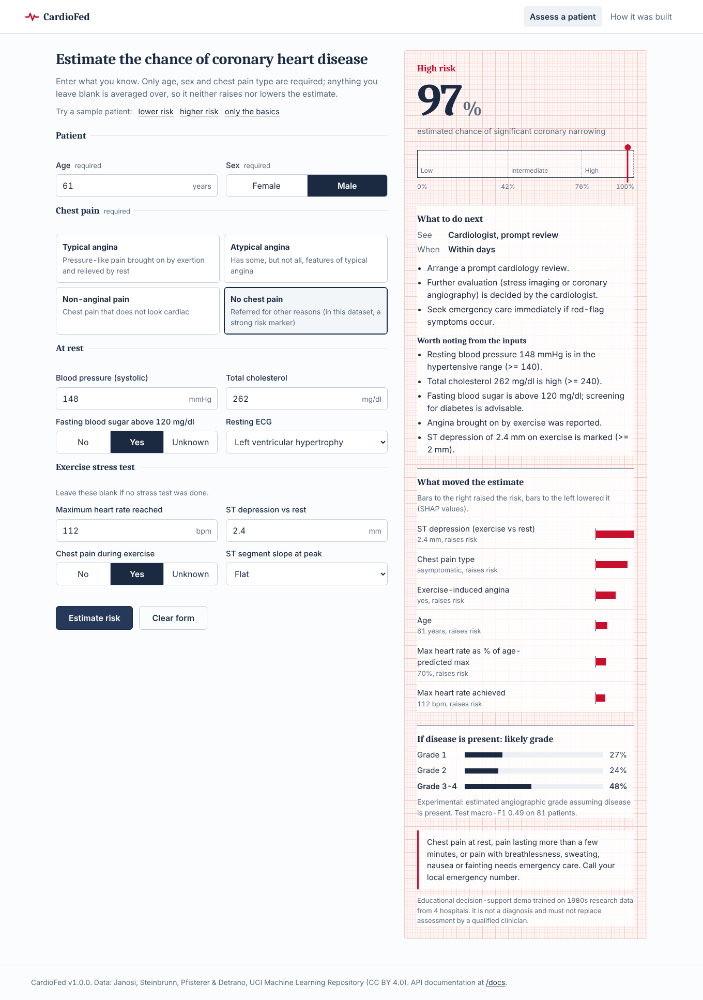
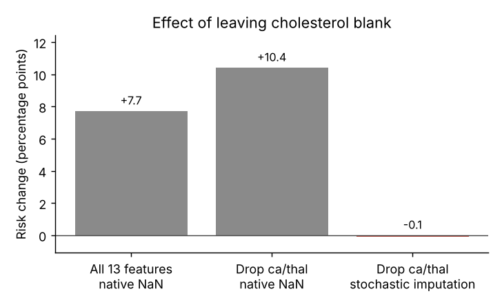
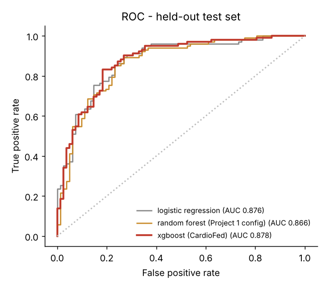
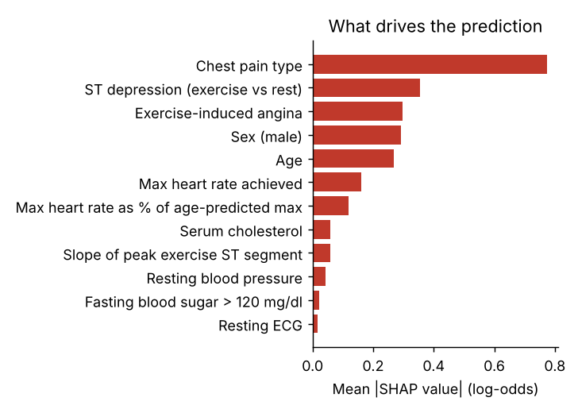
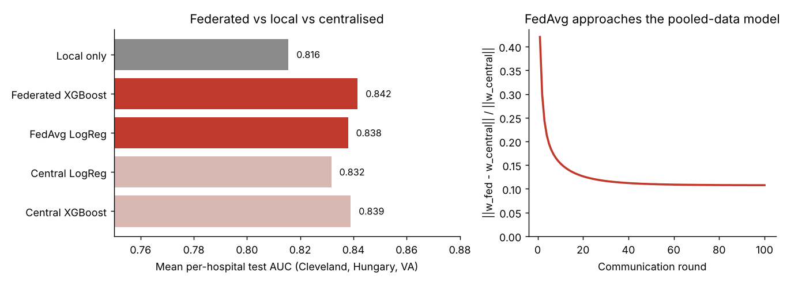

# CardioFed: heart disease risk from four hospitals, with explanations and federated learning

CardioFed estimates a patient's chance of coronary artery disease from routine clinical measurements. Every estimate comes with:
- a triage recommendation (who to see, how soon)
- the inputs that moved the risk up or down
- an experimental severity grade

It is trained on the public **UCI Heart Disease** dataset: 918 real patients from Cleveland, Budapest, Zurich/Basel and Long Beach VA. The repo also includes a **federated-learning simulation** in which the four hospitals train together without sharing patient records.



| | |
|---|---|
| **Model** | XGBoost (depth 2, 150 trees), Platt-calibrated; separate XGBoost severity model |
| **Held-out test AUC** | **0.878** (95% CI 0.826-0.924), Brier 0.136, 184 patients |
| **Unseen-hospital AUC** | 0.73-0.87 (train on 3 hospitals, test on the 4th) |
| **Screening threshold** | catches 91% of diseased test patients (specificity 68%) |
| **Federated** | federated XGBoost 0.842 mean hospital AUC vs 0.816 local-only and 0.839 centralised |
| **Stack** | pandas, scikit-learn, XGBoost, FastAPI, React 19 + TypeScript (Vite), pytest, Docker, GitHub Actions |

> Educational project. It is not a medical device, and its outputs are not medical advice.

---

## Contents
1. [Data and EDA](#1-data-and-eda)
2. [Cleaning decisions](#2-cleaning-decisions)
3. [The missing-value shortcut](#3-the-missing-value-shortcut-and-how-it-was-removed)
4. [Modelling and evaluation](#4-modelling-and-evaluation)
5. [Federated learning](#5-federated-learning)
6. [The application](#6-the-application)
7. [Run it](#7-run-it)
8. [Project structure](#8-project-structure)
9. [Limitations](#9-limitations)

---

## 1. Data and EDA

The data is the four "processed" files of the [UCI Heart Disease dataset](https://archive.ics.uci.edu/dataset/45/heart+disease) (CC BY 4.0). Each row is a patient who was referred for coronary angiography. The outcome is whether any major vessel had more than 50% narrowing.

| Hospital | Patients | With disease | Notes |
|---|---:|---:|---|
| Cleveland Clinic | 303 | 46% | complete data; the only site with `ca` |
| Hungarian Institute of Cardiology | 294 | 36% | graded outcome only as 0/1 |
| University Hospitals Zurich & Basel | 123 | 94% | **no cholesterol recorded** (coded as 0) |
| VA Long Beach | 200 | 74% | ~27% of exercise-test values missing |

The full analysis is in [`notebooks/01_eda.ipynb`](notebooks/01_eda.ipynb), which ships with its outputs already run. Key findings:

- **Missing values depend on the hospital, not on chance.** `ca` is 99% missing outside Cleveland and `thal` is 83-90% missing at two sites. A shallow decision tree can name the hospital from the pattern of blank fields alone 84% of the time, against 33% for a majority guess.
- **Zeros are hidden missing values.** All 123 Swiss patients and 49 VA patients have cholesterol = 0, and one VA patient has blood pressure = 0.
- **Disease rates range from 36% to 94% across hospitals.** Anything that reveals the hospital is therefore a proxy for the label.
- **Hungary never graded severity** (values are only 0 or 1), so its labels can't be compared with the 1-4 grades used elsewhere.
- **"No chest pain" has the highest disease rate (79%).** This is selection bias: patients sent for angiography without symptoms were referred because of other strong evidence.
- **`ca` is close to target leakage.** It counts vessels seen on fluoroscopy, which is part of the same procedure that produces the label.

## 2. Cleaning decisions

Each rule is a named step in [`src/cardiofed/data.py`](src/cardiofed/data.py). Every step logs what it changed to [`reports/data_cleaning.json`](reports/data_cleaning.json).

| Issue | Count | Decision | Why |
|---|---:|---|---|
| Exact duplicate rows | 2 | drop | a copy could land in both train and test |
| `chol = 0`, `trestbps = 0` | 172, 1 | convert to missing | physiologically impossible; these are missing-value codes |
| Values outside wide valid ranges | 0 | convert to missing | guards against future re-downloads |
| IQR outliers (e.g. cholesterol 603, BP 200) | 68 | **keep** | plausible extremes from real patients; trees only use rank order; the linear baseline clips values to the 1st-99th percentile using training-fold bounds |
| Negative ST depression | 12 | keep | means ST elevation, which is rare but clinically valid |
| `ca`, `thal` | - | drop as features | recorded at one site, partly part of the diagnosis, and mostly reveal the hospital |
| Hungarian severity labels | 293 | exclude from the severity model only | that site never recorded grades |

## 3. The missing-value shortcut, and how it was removed

The default way to handle blanks is to let XGBoost route missing values down a learned branch. Here that taught the model **"no cholesterol means sick"**, because blank cholesterol mostly meant Zurich, where 94% of patients had disease. In the app, a doctor who left the cholesterol box empty got a risk estimate about **10 points higher**.

The fix is **stochastic imputation** ([`imputation.py`](src/cardiofed/imputation.py)):
- **During training**, each missing value is filled with a random draw from the observed training values, so "was missing" carries no signal.
- **At prediction time**, missing inputs are filled 100 times and the predictions are averaged. The risk is effectively averaged over what the unknown value could be.

Results of the ablation on the training set ([`reports/feature_selection.json`](reports/feature_selection.json)):

| Variant | Internal CV AUC | Mean AUC on unseen hospital | Risk change when cholesterol is left blank |
|---|---:|---:|---:|
| All 13 features, native NaN | **0.896** | 0.807 | +7.7 pts |
| Drop `ca`/`thal`, native NaN | 0.880 | 0.811 | +10.4 pts |
| **Drop `ca`/`thal`, stochastic imputation** | 0.869 | **0.821** | **-0.1 pts** |

Internal cross-validation *falls* while accuracy on hospitals the model never saw *rises*. That pattern suggests the earlier, higher CV score partly came from the model recognising the hospital. A test (`test_leaving_a_field_blank_does_not_push_risk`) keeps the fix from regressing.



## 4. Modelling and evaluation

The protocol ([`train.py`](src/cardiofed/train.py)) never uses the test set for any decision:

1. One **80/20 split, stratified by hospital and outcome**, shared with the federated simulation.
2. Hyperparameters chosen by **5-fold CV** on the training set (depth 2-4 × 150-500 trees). Ties go to the simpler model.
3. **Platt calibration** and **triage thresholds** fitted on out-of-fold training predictions:
   - *low* below the cut-off that catches ≥ 90% of diseased patients
   - *high* above the cut-off that keeps ≥ 90% of healthy patients below it
4. Test metrics with **bootstrap 95% CIs**, compared against three baselines.
5. **Leave-one-hospital-out** external validation.
6. The deployed model is the same recipe refit on all 918 patients.

**Held-out test set (184 patients):**

| Model | AUC (95% CI) | Brier | Accuracy |
|---|---|---:|---:|
| Majority class | 0.500 | 0.247 | 0.554 |
| Logistic regression (impute → winsorise → scale) | 0.876 (0.824-0.924) | 0.137 | 0.815 |
| Random forest (the configuration from my earlier project) | 0.866 (0.809-0.915) | 0.143 | 0.815 |
| **XGBoost (CardioFed)** | **0.878 (0.826-0.924)** | **0.136** | **0.821** |

**An honest reading:** on 918 rows, XGBoost and logistic regression are statistically tied. XGBoost is kept for three reasons:
- it gives exact per-patient explanations (TreeSHAP)
- it does better on two of the four unseen hospitals
- it is clearly better at severity grading (below)

**At the triage thresholds:**
- Screening cut-off 0.37: sensitivity 0.91, specificity 0.68.
- High-risk cut-off 0.74: specificity 0.85.
- The deployed model, refit on all patients, uses cut-offs of 0.42 and 0.76.
- Calibration bins on the test set land within 6 points of the observed disease rate ([figure](reports/figures/calibration_test.png)).

**External validation:**

| Held-out hospital | Patients | Prevalence | XGBoost AUC | Log. reg. AUC |
|---|---:|---:|---:|---:|
| Cleveland | 303 | 46% | **0.868** | 0.856 |
| Hungary | 293 | 36% | 0.878 | **0.892** |
| Switzerland | 123 | 94% | **0.792** | 0.752 |
| VA Long Beach | 199 | 74% | 0.732 | **0.752** |

**Severity model** (grade 1 / 2 / 3-4, among diseased patients at the 3 grading hospitals, 81 test patients):

| | Accuracy | Macro-F1 |
|---|---:|---:|
| Majority class | 0.38 | 0.18 |
| Logistic regression | 0.42 | 0.35 |
| **XGBoost** | **0.53** | **0.49** |

It is clearly better than the baselines but still weak, so the UI labels it experimental.

**Explanations.** XGBoost's built-in TreeSHAP (`pred_contribs=True`) is averaged over the imputation draws. A unit test checks that the contributions sum to the model's logit.

<p>


</p>

## 5. Federated learning

[`federated.py`](src/cardiofed/federated.py) treats each hospital as a client that keeps its own training patients. Only aggregate statistics and model parameters leave a hospital.

| Strategy | What is shared | Cleveland | Hungary | VA | **Mean** |
|---|---|---:|---:|---:|---:|
| Local only | nothing | 0.951 | 0.829 | 0.667 | 0.816 |
| **Federated XGBoost** (n-weighted log-odds ensemble) | trained models, once | 0.949 | 0.839 | **0.737** | **0.842** |
| **FedAvg logistic regression** (100 rounds × 5 local epochs) | feature sums/counts, then weights | 0.948 | 0.849 | 0.717 | 0.838 |
| Centralised logistic regression | all patient rows | 0.950 | 0.848 | 0.697 | 0.832 |
| Centralised XGBoost | all patient rows | 0.961 | 0.849 | 0.707 | 0.839 |

What the simulation shows:

- **Collaboration helps the hospital that needs it most.** VA rises from 0.667 trained alone to 0.737 with federated XGBoost, while Cleveland, which already has enough data, loses nothing.
- **Federated models match centralised ones** without pooling records. The test sets are small (40-61 patients per hospital), so differences of about 0.01 are noise.
- **Preprocessing is federated too.** Imputation means and standardisation come from summed client statistics, not pooled rows.
- **FedAvg ends up within 11% of the centralised weights** and then plateaus. That leftover gap is *client drift* caused by very different hospitals (non-IID data), which methods such as FedProx and SCAFFOLD address. Communication cost: 62.5 KB in total.
- **A metric trap:** pooled AUC over all test patients ranks "local only" *highest* (0.884). Each local model has learned its own hospital's disease rate, and pooling rewards telling hospitals apart. Comparisons therefore use the mean of per-hospital AUCs. Zurich is excluded because its test set has only 2 healthy patients.



## 6. The application

FastAPI serves both the API and the web UI from one process.

| Endpoint | Auth | Purpose |
|---|---|---|
| `GET /api/health` | - | liveness check |
| `GET /api/model` | - | model card: data, metrics, external and federated results, thresholds |
| `POST /api/predict` | key or UI session | one patient → risk, tier, recommendation, drivers, severity, warnings |
| `POST /api/predict/batch` | key or UI session | up to 100 patients |
| `POST /api/session` | same-origin only | signed, 1-hour cookie for the bundled UI |
| `/docs` | - | interactive OpenAPI documentation |

```bash
curl -s localhost:8000/api/predict -H "X-API-Key: $CARDIOFED_API_KEY" -H "Content-Type: application/json" \
  -d '{"age": 58, "sex": "male", "cp": "asymptomatic", "exang": "yes", "oldpeak": 1.8}'
```

What the API does:

- **Strict validation.** Unknown fields are rejected (422), so a typo like `"cholesterol"` isn't silently ignored. Impossible values and wrong vocabulary are rejected too. The categories and ranges come from the same config the model uses.
- **One auth rule for every prediction route**: an API key or a signed session cookie. There are no unprotected duplicate endpoints.
- **Safe defaults.** Without a key, the server starts in development with a temporary key printed to the log. In `CARDIOFED_ENV=production` it refuses to start without one.
- **HMAC-signed session tokens with expiry.** They work across workers and inside Docker; a per-process random token would not.
- Per-client rate limiting, a strict Content-Security-Policy (no third-party scripts), and request logs that never contain patient data.
- **Input warnings.** The response flags values outside the training range and lists the fields that were averaged over.
- **Model files saved as native XGBoost Booster JSON**, which stays loadable across xgboost and scikit-learn versions.

The UI is a **React 19 + TypeScript** single-page app built with **Vite** (`frontend/`):

- `PatientForm` holds the form as controlled state and validates in the browser with the same ranges the API enforces.
- `ResultPanel` shows the risk, the ECG-paper strip (its zones are the model's real triage thresholds), the recommendation, the SHAP drivers and the severity grades.
- `ModelView` renders the model card from `GET /api/model`.
- `api.ts` and `types.ts` give the backend a typed client that mirrors the Pydantic response models.

React escapes all server text, and the production build loads only same-origin scripts, so the strict Content-Security-Policy stays on. FastAPI serves the built app from `frontend/dist`. The build is committed, so the app works after `pip install` without Node; `npm run build` regenerates it.

## 7. Run it

```bash
git clone <this repo> && cd cardiofed
python -m venv .venv && source .venv/bin/activate      # Windows: .venv\Scripts\activate
pip install -e ".[dev]"

uvicorn cardiofed.api.main:app --reload                 # open http://localhost:8000
```

The trained model and the built UI are committed, so the app runs straight away.

To work on the React UI (Node 20+), keep the backend running and in a second terminal run:

```bash
cd frontend
npm install
npm run dev        # http://localhost:5173, hot reload, /api proxied to :8000
npm run build      # type-check + production build into frontend/dist
``` To reproduce everything from the raw data:

```bash
python -m cardiofed.data download --force   # re-fetch the 4 files from UCI and verify row counts
python -m cardiofed.data clean              # -> data/processed/heart_clean.csv + reports/data_cleaning.json
python -m cardiofed.train                   # ablation, tuning, evaluation, figures, models/  (~20 s)
python -m cardiofed.federated               # -> reports/federated.json + figure
pytest                                      # 32 tests
jupyter lab notebooks/01_eda.ipynb
```

With Docker:

```bash
docker build -t cardiofed .
docker run --rm -p 8000:8000 -e CARDIOFED_API_KEY=$(python -c "import secrets;print(secrets.token_urlsafe(32))") cardiofed
```

All settings are optional and listed in [`.env.example`](.env.example).

## 8. Project structure

```
src/cardiofed/
  config.py        paths, columns, category codes, valid ranges (one source of truth)
  data.py          download, load, clean (every rule logged)
  features.py      feature engineering shared by training, simulation and API
  imputation.py    stochastic imputation (the shortcut fix)
  model.py         XGBoost wrapper: calibration, triage tiers, SHAP, version-proof save/load
  evaluation.py    stratified split, bootstrap CIs, threshold selection
  train.py         ablation -> tuning -> test -> external validation -> severity -> deploy
  federated.py     local vs FedAvg vs federated XGBoost vs centralised
  triage.py        tier -> referral, urgency, next steps, risk-factor notes
  predictor.py     service layer used by the API
  api/             FastAPI app, schemas, auth/sessions/rate limiting
frontend/          React + TypeScript UI (Vite)
  src/components/  PatientForm, ResultPanel, ModelView, form controls
  src/api.ts       typed API client (session cookie, error messages)
  dist/            production build served by FastAPI
notebooks/         01_eda.ipynb (executed)
reports/           metrics.json, feature_selection.json, federated.json, data_cleaning.json, figures/
models/            presence_model.json, severity_model.json, meta.json
tests/             data, model behaviour (incl. shortcut regression), API security
```

## 9. Limitations

- **Old and selected population.** These are 1980s patients already referred for angiography. Absolute risks don't transfer to the general population, and the "no chest pain = high risk" pattern is a referral artefact.
- **Small data.** The test set has 184 patients and the per-hospital test sets have 25-61, so the confidence intervals are wide.
- **Calibration depends on the hospital.** Prevalence ranges from 36% to 94%. A new site would need recalibration on local data, which a federated setting can provide.
- **The federated part is a simulation.** It runs in one process, uses no secure aggregation and no differential privacy, and the federated XGBoost is a model ensemble rather than federated tree-growing (e.g. XGBoost's federated plugin or histogram aggregation).
- **The triage rules are illustrative**, not clinical guidelines.

Data citation: Janosi, A., Steinbrunn, W., Pfisterer, M., & Detrano, R. (1988). *Heart Disease* [Dataset]. UCI Machine Learning Repository. https://doi.org/10.24432/C52P4X
